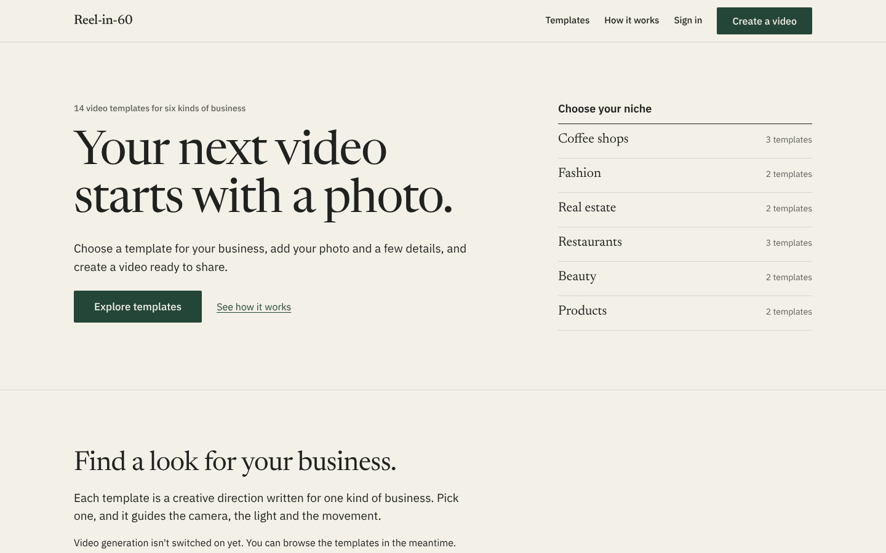

# Photo-to-video ads

Self-serve, credit-based web app that turns one product photo into a vertical video ad
(TikTok, Reels, Snapchat). See `docs/PLAN.md` for the business plan and build order, and
`docs/RENDER-TEST.md` for the first render-test results.

**Current focus (from 15 Nov 2026): social media templates.** The library is in
`docs/SOCIAL-TEMPLATES.md`: 50 copy-and-paste post templates across 10 niches. The video work
below is paused.

## The web service

```bash
npm install
PAYMENTS=test ENGINE=mock npm start     # http://localhost:3000
npm test                                # 11 end-to-end tests, no cost
```

Sign up, buy the pack (test payments grant credits without charging), pick a style, optionally add a
product photo, and order a video. One credit is taken per order and refunded automatically if the
video fails. With `ENGINE=mock` every order delivers a sample video after a few seconds, for free.
`ENGINE=fal` generates a real video with Kling v4 (about $0.79 per 5 seconds).

Going live (Moyasar payments, Railway hosting): see `docs/DEPLOY.md`. Settings: `.env.example`.



## Template packs

- `docs/packs/coffee-shops-ar.md`: the Arabic pack "شهر قهوة" (30 templates + calendar). This file is the
  single source of the text. Listing and sales page: `docs/packs/coffee-shops-ar-listing.md`.
- PDFs: `docs/packs/shahr-qahwa.pdf` (full pack) and `docs/packs/shahr-qahwa-preview.pdf` (5 free templates).

Rebuild the PDFs after editing the markdown:

```bash
python3 packs/build_pdf.py docs/packs/coffee-shops-ar.md
node packs/print-pdf.mjs
cp packs/build/*.pdf docs/packs/
```

Needs Chromium via Playwright (pre-installed in cloud sessions, not a project dependency). Fonts
(IBM Plex Sans Arabic, OFL licence) are in `packs/fonts/`. Brand name, price, preview picks and the
store link are in `BRAND` at the top of `packs/build_pdf.py`.

## Render test (week 1)

A command-line script: product photo + template → silent, text-free 1080×1920 mp4.

Needs Node 22.21+ and `ffmpeg` on the PATH. fal.ai key: set `FAL_KEY`, or in cloud sessions
add it as a network secret (`Authorization: Key …` for `*.fal.run` and `*.fal.ai`).

```bash
npm install
npm run samples                                   # download the test photos (samples/sources.json)
npm run scenes -- --template fragrance            # build scenes once (~$0.40 each, skips existing)
npm run render -- --photo samples/fragrance-02.jpg --template fragrance
```

Options for `render`: `--scene <n>` to pick a scene, `--subject "perfume bottle"` to name the product.
Templates: `templates/*.json` (`fragrance`, `coffee`, `real-estate`).

## Fully AI-generated video and the finishing pass

```bash
npm run ai-video -- --spec ads/coffee-machine.json      # paid: Flux 2 Pro still + Kling v4 video
npm run finish -- --video ads/coffee-machine.mp4 --spec ads/coffee-machine.json   # free
```

- `ai-video` reads prompts and length from `ads/<id>.json` and skips anything already generated.
- `finish` costs nothing. It cuts the clip into the shots listed under `edit.shots` in the spec
  (cuts, punch-ins, speed changes) and applies a look from `looks/*.json` (softer colour, less
  sharpness, grain, lens fringing, vignette, handheld shake). Output: `<video>-finished.mp4`.
- `ads/coffee-machine-phone.json` is a phone-footage-style prompt that has not been generated yet.

- Spending cap: `$5` by default (`BUDGET_USD` to change). Every paid call is checked first and
  logged in `data/spend.csv`.
- Each render is logged in `data/runs.csv`. Videos go to `out/` (not committed).
- In cloud sessions, prefix commands with `NODE_USE_ENV_PROXY=1` so Node uses the network proxy.

The previous project in this repo (estate-agency AI assistant and AI receptionist) is in
git history and on `main`.
